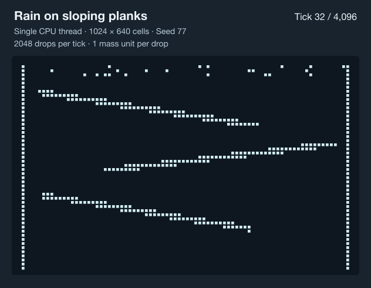

# MacMetalDemo

A Kotlin/Native terminal app for macOS on Apple Silicon.
Compare CPU and GPU performance with N-body, Conway's Game of Life, and Rain Water.
N-body models gravity between particles. Life updates cells from their eight neighbors.
Rain Water shows a downpour from the side. Water runs along three sloping planks and falls from their tips.
The executable does not need a JVM.


## Features

- Three modes: one CPU thread, multiple CPU threads, and GPU calculations through Metal.
- The same initial state, rules, and amount of work in all three modes for each simulation.
- Live progress, calculation speed, estimated time left, and results.
- System CPU load for each core and separate CPU use for the app.
- Optional system GPU activity, history, and command duration in Metal mode.
- Optional live views of all three simulations in the terminal.

## Build and run

The build needs macOS on Apple Silicon, Xcode with the macOS SDK, and JDK 21.
The project uses Kotlin 2.4.10 and Gradle 9.1.0.

Run these commands from the repository root:

```sh
./gradlew check
./gradlew :app:linkReleaseExecutableMacosArm64
./app/build/bin/macosArm64/releaseExecutable/MacMetalDemo.kexe
```

1. Select `1` for N-body, `2` for Game of Life, or `3` for Rain Water.
2. Select an execution mode.
3. Enter the parameters for the selected algorithm. Press Enter to accept the value in brackets.
4. In full-screen mode, choose whether to show the simulation.

| Algorithm | Input order | First defaults |
|---|---|---|
| N-body | Particle count, step count, seed | 16,384 particles, 1,000 steps, seed 42 |
| Game of Life | Board width, board height, live cells at start, generation count, seed | 512 × 384 cells, 1,000 live cells, 1,000 generations, seed 42 |
| Rain Water | Field width, field height, drops per tick, mass per drop, tick count, seed | 1024 × 640 cells, 2,048 drops per tick, mass 1, 4,096 ticks, seed 77 |

The initial population cannot exceed the board size. For a new session on a 20 × 15 board, the default is 300.
Each generation updates the whole board. Neighbors wrap across the edges.
The result shows the final population and a hash for comparing cell arrangements.

To try a five-cell glider, enter `5`, `5`, `5`, `4`, and `120509` in the Life prompts.
In four generations, the glider moves one cell right and one cell down.
Use more generations to watch it move. Very short runs can finish before the screen refreshes.
Small boards show individual cells. Larger boards show the whole field beside a close view of nine rows and nine columns.
If only measurements appear, enlarge the terminal. A window with 120 columns and 32 rows fits both views on the tested Mac.

For Rain Water, select `3` and accept the defaults to watch the downpour.
Each tick releases between 1 and 16,384 drops across the top. Mass per drop sets how much water each drop carries.
The seed sets both the rain sequence and the plank positions. Reuse the seed to repeat the scene.
The upper and lower planks slope right. The middle plank slopes left. Water can fall from each tip onto the plank below.
Solid lines show the planks. Sparse dots show falling rain. Denser patches show runoff and pools. Water drains through the bottom edge.
Each cell stores water mass. A terminal dot can represent many cells and drops.
The result checks that admitted mass equals stored mass plus drained mass. Rejected mass is rain that could not enter a full inlet.
The model represents gravity and runoff. It does not calculate pressure, momentum, or splashes.



The recording shows runoff below the upper, middle, and lower tips near ticks 270, 800, and 1,330.

Use the same parameters and visualization choice when you compare modes.
Run CPU (all cores) and GPU (Metal) in either order within one session.
After the second run, the result shows both calculation times and the faster mode.
Run the single-thread mode first if you also want a comparison with one CPU thread.
GPU activity describes the whole system, including other apps. It shows `N/A` when unavailable.

## Development

Algorithms use separate Gradle modules and the `DemoAlgorithm` interface.
They share the terminal, timing, and monitoring code.

On 2026-11-15, the tests and release build ran on an Apple M1 Pro with macOS 27.0.1.
The build used Kotlin/Native 2.4.10, Gradle 9.1.0, Temurin 21.0.10+7, Xcode 27.2, and macOS SDK 27.2.
All 324 native tests passed.
The backend tests compared every final cell across both CPU modes and real Metal.
Each release mode completed 40 updates on a 5 × 4 board with seven starting cells, two generations, and seed 42.
All three produced eight live cells and board hash `bd6d954ad643a01d`.
With the default board, seed, and starting population, all three modes also completed 8,000 generations with the live view on.
Each mode produced 4,899 live cells and board hash `d76adaacfba0d226`.
Rain Water tests compare every cell and both mass counters per column across all three modes.
Gradle writes the test reports to each module's `build/reports/tests/macosArm64Test/index.html`.

## Rain Water run comparison

The release executable ran on the same M1 Pro with 10 CPU cores and 16 GPU cores. Visualization was off.
Both fields received 2,048 drops per tick, with mass 1, for 4,096 ticks using seed 77.
The table gives calculation times. Each parallel CPU and Metal time is the median of three runs. Each single-thread time is one run.

| Field | One CPU thread | All CPU cores | GPU (Metal) | Faster of all cores and Metal | Final hash in all modes |
|---|---:|---:|---:|---|---|
| 160 × 96 | 0.789 s | 0.851 s | 1.144 s | CPU, 1.34× | `13f5ba93b5a27446` |
| 1024 × 640 | 24.922 s | 6.033 s | 1.666 s | GPU, 3.62× | `ef057c489e853b9a` |

Each GPU tick submits four passes in one command buffer. The next tick depends on the previous one.
A larger field gives the GPU more independent cells per pass. More ticks repeat the same work in sequence.
The large field admitted all 8,388,608 mass units. It drained 1,256,069 units and retained 7,132,539.

## N-body run comparison

Recorded on 2026-11-15 with the release executable on an Apple M1 Pro with 10 CPU cores and 16 GPU cores.
Each mode ran once with 16,384 particles, 1,000 steps, and seed 42. Visualization was off.
Each run completed 268,419,072,000 particle interactions. The times cover calculation only.

| Mode | Calculation time | Speedup vs. one CPU thread |
|---|---:|---:|
| CPU - one thread | 478.895 s | 1.00× |
| CPU - all cores | 72.655 s | 6.59× |
| GPU - Metal | 8.736 s | 54.82× |

Results can change with hardware and system activity.
