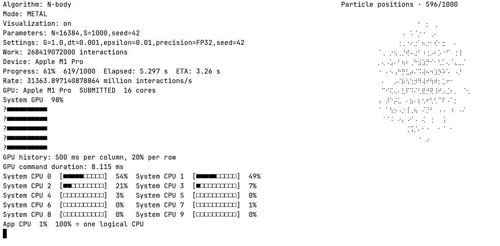

# MacMetalDemo

A Kotlin/Native terminal app for macOS on Apple Silicon.
Compare CPU and GPU performance with N-body, Conway's Game of Life, and Rain Water.
N-body models gravity between particles. Life updates cells from their eight neighbors.
Rain Water shows a downpour from the side. Water runs along three sloping planks and falls from their tips.
The executable does not need a JVM.



## Features

- Three modes: one CPU thread, multiple CPU threads, and GPU calculations through Metal.
- The same initial state, rules, and amount of work in all three modes for each simulation.
- Live progress, calculation speed, estimated time left, and results.
- System CPU load for each core and separate CPU use for the app.
- Optional system GPU activity, history, and command duration in Metal mode.
- Optional live views of all three simulations in the terminal.

## Build and run

The build needs macOS on Apple Silicon, Xcode with the macOS SDK, and JDK 21.
The project uses Kotlin 2.4.10 and Gradle 9.1.0.

Run these commands from the repository root:

```sh
./gradlew check
./gradlew :app:linkReleaseExecutableMacosArm64
./app/build/bin/macosArm64/releaseExecutable/MacMetalDemo.kexe
```

1. Select `1` for N-body, `2` for Game of Life, or `3` for Rain Water.
2. Select an execution mode.
3. Enter the parameters for the selected algorithm. Press Enter to accept the value in brackets.
4. In full-screen mode, choose whether to show the simulation.

| Algorithm | Input order | First defaults |
|---|---|---|
| N-body | Particle count, step count, seed | 16,384 particles, 1,000 steps, seed 42 |
| Game of Life | Board width, board height, live cells at start, generation count, seed | 512 × 384 cells, 1,000 live cells, 1,000 generations, seed 42 |
| Rain Water | Field width, field height, drops per tick, mass per drop, tick count, seed | 1024 × 640 cells, 2,048 drops per tick, mass 1, 4,096 ticks, seed 77 |

The Life initial population cannot exceed the board size.
For Rain Water, select `3` and accept the defaults to watch the downpour.
Reuse the seed to repeat the rain sequence and plank positions.


Use the same parameters and visualization choice when you compare modes.
Run CPU (all cores) and GPU (Metal) in either order within one session.
After the second run, the result shows both calculation times and the faster mode.
Run the single-thread mode first if you also want a comparison with one CPU thread.
GPU activity describes the whole system, including other apps. It shows `N/A` when unavailable.

## Development

On 2026-11-15, the tests and release build ran on an Apple M1 Pro with macOS 27.0.1.
The build used Kotlin/Native 2.4.10, Gradle 9.1.0, Temurin 21.0.10+7, Xcode 27.2, and macOS SDK 27.2.
All 324 native tests passed.
Gradle writes the test reports to each module's `build/reports/tests/macosArm64Test/index.html`.

## Rain Water run comparison

The release executable ran on the same M1 Pro with 10 CPU cores and 16 GPU cores. Visualization was off.
Both fields received 2,048 drops per tick, with mass 1, for 4,096 ticks using seed 77.
The table gives calculation times. Each parallel CPU and Metal time is the median of three runs. Each single-thread time is one run.

| Field | One CPU thread | All CPU cores | GPU (Metal) | Faster of all cores and Metal |
|---|---:|---:|---:|---|
| 160 × 96 | 0.789 s | 0.851 s | 1.144 s | CPU, 1.34× |
| 1024 × 640 | 24.922 s | 6.033 s | 1.666 s | GPU, 3.62× |

## N-body run comparison

Recorded on 2026-11-15 with the release executable on an Apple M1 Pro with 10 CPU cores and 16 GPU cores.
Each mode ran once with 16,384 particles, 1,000 steps, and seed 42. Visualization was off.
Each run completed 268,419,072,000 particle interactions. The times cover calculation only.

| Mode | Calculation time | Speedup vs. one CPU thread |
|---|---:|---:|
| CPU - one thread | 478.895 s | 1.00× |
| CPU - all cores | 72.655 s | 6.59× |
| GPU - Metal | 8.736 s | 54.82× |

Results can change with hardware and system activity.
